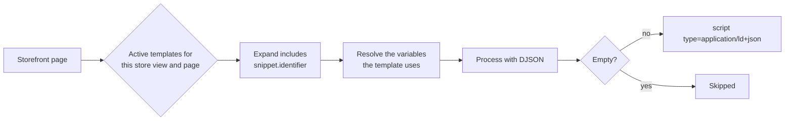

# Rich Snippets DJSON examples

Every structured-data template that ships with **Rich Snippets**, the JSON-LD module of the qoliber SEO Suite for Magento 2 and Mage-OS. Each template comes with the output it produces on a real store, plus a guide to writing your own.

The templates are written in **DJSON**, qoliber's dynamic JSON templating language. For DJSON documentation and updates, see **[djson.dev](https://djson.dev)**.

A template is plain JSON with variables, conditions and loops:

```json
{
    "@type": "AggregateRating",
    "ratingValue": "{{product.ratingSummary}}",
    "reviewCount": "{{product.reviewCount}}",
    "bestRating": "5",
    "worstRating": "1"
}
```

On a product page, the module turns it into JSON-LD for search engines:

```json
{
    "@type": "AggregateRating",
    "ratingValue": "3.3",
    "reviewCount": "4",
    "bestRating": "5",
    "worstRating": "1"
}
```

## What's in this repository

| Path | Contents |
|---|---|
| [`snippets/`](snippets/) | All 27 templates the module installs, grouped by where they are used. Each folder has `template.json` (exactly as installed), `output.json` (what it renders) and a README. |
| [`docs/how-snippets-work.md`](docs/how-snippets-work.md) | How the module picks the templates for a page and turns them into JSON-LD. |
| [`docs/djson-syntax.md`](docs/djson-syntax.md) | The DJSON you can use in a template: variables, conditions, loops and includes. |
| [`docs/variables.md`](docs/variables.md) | Every variable a template can use, with example values. |

The templates match **qoliber/seo-rich-snippets 2.7.0**, shipped with SEO Suite 2.10.0.

## The templates

The module installs all 27, switched off. Nothing is published until you switch the module on and activate the templates you want.

### Product pages

| Template | schema.org type | Shown on by default | What it publishes |
|---|---|---|---|
| [`product`](snippets/product-pages/product/) | [Product](https://schema.org/Product) | Product Page | The product itself: name, description, SKU, image and brand, with its offer, rating and reviews when it has them. |
| [`offer`](snippets/product-pages/offer/) | [Offer](https://schema.org/Offer) | nowhere on its own | The offer the product page makes: price, currency, availability and URL, plus your shipping and return policies. |
| [`aggregate-rating`](snippets/product-pages/aggregate-rating/) | [AggregateRating](https://schema.org/AggregateRating) | nowhere on its own | The average of the product's approved ratings on a 1–5 scale, with the number of reviews. |
| [`review`](snippets/product-pages/review/) | [Review](https://schema.org/Review) | nowhere on its own | One approved customer review: rating, author, text and date. |
| [`product-group`](snippets/product-pages/product-group/) | [ProductGroup](https://schema.org/ProductGroup) | Product Page | A configurable product as a ProductGroup with every variant and its own offer. |
| [`offer-shipping-details`](snippets/product-pages/offer-shipping-details/) | [Product](https://schema.org/Product) | Product Page | An alternative, self-contained Product with an inline Offer and shipping and return policies. |

### Shipping and returns

| Template | schema.org type | Shown on by default | What it publishes |
|---|---|---|---|
| [`shipping-details`](snippets/shipping-and-returns/shipping-details/) | [OfferShippingDetails](https://schema.org/OfferShippingDetails) | nowhere on its own | Your configured shipping rate and destination, for the offer. |
| [`merchant-return-policy`](snippets/shipping-and-returns/merchant-return-policy/) | [MerchantReturnPolicy](https://schema.org/MerchantReturnPolicy) | nowhere on its own | Your configured return policy: country, return window, method and who pays. |
| [`shipping-rate-settings`](snippets/shipping-and-returns/shipping-rate-settings/) | [OfferShippingDetails](https://schema.org/OfferShippingDetails) | nowhere on its own | The same configured shipping policy as shipping-details, under the name offer-shipping-details uses. |
| [`shipping-delivery-time`](snippets/shipping-and-returns/shipping-delivery-time/) | [ShippingDeliveryTime](https://schema.org/ShippingDeliveryTime) | nowhere on its own | An empty placeholder for your handling and transit times. |

### Breadcrumbs and listings

| Template | schema.org type | Shown on by default | What it publishes |
|---|---|---|---|
| [`breadcrumb-list`](snippets/navigation/breadcrumb-list/) | [BreadcrumbList](https://schema.org/BreadcrumbList) | Category Page, Product Page | The page's breadcrumb trail, from the home page to the current page. |
| [`item-list`](snippets/navigation/item-list/) | [ItemList](https://schema.org/ItemList) | Category Page | The products of the current category listing, in order. |

### Your business

| Template | schema.org type | Shown on by default | What it publishes |
|---|---|---|---|
| [`organization`](snippets/organization/organization/) | [Organization](https://schema.org/Organization) | Homepage | Your company: name, URL, logo, address, social profiles and customer-service contact. |
| [`organization-address`](snippets/organization/organization-address/) | [PostalAddress](https://schema.org/PostalAddress) | nowhere on its own | Your postal address from Store Information. |
| [`organization-social-links`](snippets/organization/organization-social-links/) | sameAs (list of URLs) | nowhere on its own | The list of your social profile URLs, for the organization's sameAs. |
| [`local-business`](snippets/organization/local-business/) | [LocalBusiness](https://schema.org/LocalBusiness) | Contact Page | A physical shop: contact details, address, opening hours and price range from Store Information. |
| [`store`](snippets/organization/store/) | [Store](https://schema.org/Store) | nowhere until you choose | A retail shop with its address, opening hours and price range from Store Information. |

### Site and pages

| Template | schema.org type | Shown on by default | What it publishes |
|---|---|---|---|
| [`website`](snippets/site-and-pages/website/) | [WebSite](https://schema.org/WebSite) | Homepage | Your website, with a SearchAction pointing at the catalog search. |
| [`search-action`](snippets/site-and-pages/search-action/) | [SearchAction](https://schema.org/SearchAction) | nowhere on its own | A standalone SearchAction in the EntryPoint form, ready to include. |
| [`webpage`](snippets/site-and-pages/webpage/) | [WebPage](https://schema.org/WebPage) | nowhere until you choose | The page it is published on: its title, meta description and URL, with the organization as publisher. |
| [`about-page`](snippets/site-and-pages/about-page/) | [AboutPage](https://schema.org/AboutPage) | nowhere until you choose | Your About page, with the organization as its main entity. |
| [`contact-page`](snippets/site-and-pages/contact-page/) | [ContactPage](https://schema.org/ContactPage) | Contact Page | Your Contact page, with a customer-service contact point. |

### Content demos

| Template | schema.org type | Shown on by default | What it publishes |
|---|---|---|---|
| [`article`](snippets/content-demos/article/) | [Article](https://schema.org/Article) | nowhere until you choose | A blog article with author and publisher. (demo) |
| [`faq-page`](snippets/content-demos/faq-page/) | [FAQPage](https://schema.org/FAQPage) | nowhere until you choose | Frequently asked questions with their answers. (demo) |
| [`howto`](snippets/content-demos/howto/) | [HowTo](https://schema.org/HowTo) | nowhere until you choose | Step-by-step instructions. (demo) |
| [`qa-page`](snippets/content-demos/qa-page/) | [QAPage](https://schema.org/QAPage) | nowhere until you choose | A page built around one question and its answers. (demo) |
| [`video-object`](snippets/content-demos/video-object/) | [VideoObject](https://schema.org/VideoObject) | nowhere until you choose | A product video with thumbnail, duration and URLs. (demo) |

## Quick start: product structured data

1. **Stores → Configuration → Qoliber → SEO: Rich Snippets**: set **Enabled** to **Yes** and save.
2. **Qoliber → SeoRichSnippets → Schema Templates**: tick **product**, **offer**, **aggregate-rating**, **review** and **breadcrumb-list**, then choose **Actions → Enable**.
3. Flush the full-page cache.
4. Test a product URL with Google's [Rich Results Test](https://search.google.com/test/rich-results).

The product page now publishes one Product with its offer, rating and reviews, and a BreadcrumbList. For configurable products, also map your variant attributes under **Configurable Variant Attributes** and enable **product-group**. The page then publishes a ProductGroup with an offer for every variant.

## Recommended sets

| Page | Switch on | The page publishes |
|---|---|---|
| Simple, virtual, downloadable or bundle product | `product`, `offer`, `aggregate-rating`, `review`, `breadcrumb-list` | one Product with its Offer, rating and reviews, and the breadcrumb trail |
| Configurable product | the set above plus `product-group`, with **Configurable Variant Attributes** mapped | one ProductGroup with an Offer per variant, and the breadcrumb trail |
| Category | `breadcrumb-list`, `item-list` | the breadcrumb trail and the listed products |
| Home page | `organization`, `organization-address`, `organization-social-links`, `website` | your company and your website |
| Every offer, with policies | `shipping-details`, `merchant-return-policy`, with **Merchant Shipping and Returns** configured | `shippingDetails` and `hasMerchantReturnPolicy` on the offer |

## How a template becomes JSON-LD



- A template is published on a page when it is active, assigned to the store view (or All Store Views), and matches the page by **page type**, **specific CMS page**, **custom URL pattern** or **custom layout handle**.
- `"{{snippet.identifier}}"` pastes another active template in place. An inactive or missing one is left out of its parent, never published as `""`.
- A value that is exactly `"{{variable}}"` keeps its type, so it can be a number, an object or a list. A variable inside longer text is pasted in as text.
- A template that renders nothing (`{}`, `[]` or `null`) is skipped.
- Each template becomes its own `<script type="application/ld+json">` element.

The full story is in [docs/how-snippets-work.md](docs/how-snippets-work.md).

## Write your own template

Add a template in **Qoliber → SeoRichSnippets → Schema Templates**. Give it a unique identifier, choose the store views and where it appears, and write the JSON. The editor's **Variables & Snippets** panel lists everything you can insert. For example, a FAQ for your shipping page, shown on every URL under `/shipping`:

```json
{
    "@context": "https://schema.org/",
    "@type": "FAQPage",
    "mainEntity": [
        {
            "@type": "Question",
            "name": "Does {{config.general.store_information.name}} ship abroad?",
            "acceptedAnswer": { "@type": "Answer", "text": "Yes, we ship to every country in the EU." }
        }
    ]
}
```

Set its **Custom URL Pattern** to `/shipping*`. The syntax is in [docs/djson-syntax.md](docs/djson-syntax.md), and the full DJSON language, with updates, is at [djson.dev](https://djson.dev).

## Templates that need your details first

Some shipped templates hold placeholder values. Edit them before you switch them on:

- **organization-social-links**: placeholder profile URLs, which **organization** would publish.
- **organization**: a fixed logo path.
- **local-business**, **store**: nothing to replace since 2.7.0, but fill in Store Information (name, phone, address, Store Hours of Operation, Price Range): unset values are left out.
- **about-page**, **contact-page**: fixed texts and URLs.
- **article**, **faq-page**, **howto**, **qa-page**, **video-object**: demos to copy, one per page you mark up.

## About the example output

The outputs were rendered by the module itself, through the same pipeline as the storefront, on Mage-OS with Magento's Luma sample data. Every template was switched on, and the store had:

- Store Information: *Example Store*, 123 Example Street, Springfield 12345, US, +1 555 0100, hello@example.com, open Mo-Fr 09:00-17:00, price range `$$`; a default meta description and a header logo.
- The home page: title *Home Page* and a meta description, as a CMS home page sets them.
- Merchant Shipping and Returns: free shipping to the US; 30-day returns by mail, free of charge.

The host is replaced with `www.example.com`, and long lists are trimmed where a README says so. The outputs are pretty-printed. Your store emits compact JSON unless **JSON Output Mode** is set to **Pretty Print (Debug)**.

## Links

- DJSON documentation and updates: [djson.dev](https://djson.dev) · library: [qoliber/djson](https://github.com/qoliber/djson)
- [schema.org](https://schema.org)
- [Google Search Central: structured data](https://developers.google.com/search/docs/appearance/structured-data/intro-structured-data)
- [Rich Results Test](https://search.google.com/test/rich-results) · [Schema Markup Validator](https://validator.schema.org/)
- [qoliber](https://qoliber.com)
