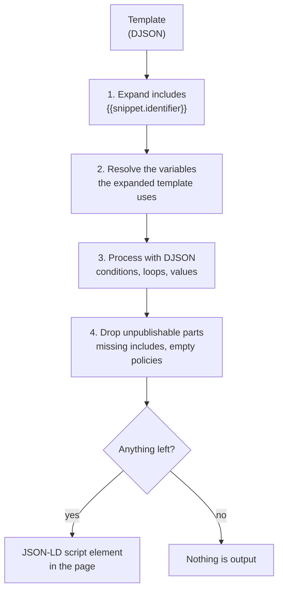

# How snippets work

Rich Snippets publishes schema.org structured data as JSON-LD. You decide what each page publishes with **snippets**: templates you write in the admin, in [DJSON](https://djson.dev). This page follows a snippet from the admin to the page source.

## A snippet

Every snippet is managed under **Qoliber → SeoRichSnippets → Schema Templates** and has:

| Field | What it does |
|---|---|
| **Name** | A label for the grid. |
| **Identifier** | A unique name, such as `offer`. Other snippets include this one by it: `"{{snippet.offer}}"`. |
| **Enable Snippet** | Only active snippets are published or included. |
| **Store View** | The store views the snippet applies to, or All Store Views. |
| **Page Types** | Homepage, Category Page, Product Page, Contact Page. |
| **Specific CMS Pages** | Individual CMS pages. |
| **Custom URL Pattern** | A path such as `/about-us`, or one with `*` wildcards such as `/blog/*`. |
| **Custom Handle (Advanced)** | A full action name such as `catalog_product_view`. |
| **JSON Schema Editor** | The DJSON template. The **Variables & Snippets** panel beside it lists what you can insert. |

The module installs 27 snippets, all inactive. You can edit them, switch them on, or add your own.

## Which snippets a page publishes

On each storefront page, the module takes the snippets that are active and assigned to the current store view (or All Store Views). It publishes those that match the page in **any** of these ways:

1. its **Page Types** include the type of the current page;
2. the page is a CMS page listed under **Specific CMS Pages**;
3. the request path matches the **Custom URL Pattern**. The query string and the leading and trailing slashes are ignored, and `*` matches anything;
4. the page's full action name equals the **Custom Handle**.

A snippet with none of these set is never published on its own. That is how the building blocks work: **offer**, **review** and **organization-address** only appear inside the snippets that include them.

## From template to JSON-LD

### 1. Includes

Every `"{{snippet.identifier}}"` in the template is replaced by that snippet's template, before anything is rendered. Included snippets can include others, so **product** pulls in **offer**, which pulls in **shipping-details** and **merchant-return-policy**.

- Only **active** snippets are included. An include that is inactive or does not exist is left out of its parent, and is never published as `""`. For a list filled by a loop over an inactive snippet, the whole property is left out.
- Includes nest up to five levels deep.
- The editor refuses a template that includes an unknown identifier, includes itself, or forms a loop with another snippet.
- You cannot delete or rename a snippet that an active snippet still includes. You can deactivate it; the admin then names the active snippets whose property is now left out.

Write an include as a whole JSON value, in quotes: `"offers": "{{snippet.offer}}"`.

### 2. Variables

The module reads the expanded template, finds the variables it uses and computes only those. A template that uses no breadcrumbs never builds the breadcrumb trail, so unused data costs nothing. The data comes from the current page: the product on a product page, the category on a category page, and store configuration everywhere. [variables.md](variables.md) lists all of it.

### 3. DJSON

The template and the resolved data go through the [DJSON](https://djson.dev) engine, which applies the conditions and loops and fills in the values:

- A value that is exactly `"{{variable}}"` takes the variable's own type: a number, an object or a list. `"{{commerce.offer.price}}"` becomes `55`, and `"{{merchant.returnPolicy}}"` a whole MerchantReturnPolicy object.
- A variable inside longer text is pasted in as text: `"{{config.web.secure.base_url}}about-us"`.
- A whole-value variable with no value becomes `null`. Inside text, it is left out. A loop over missing data gives an empty list `[]`.

That is why the shipped templates guard optional data with conditions: `"@djson if product.ratingValue"` publishes the rating only for products that have one. [djson-syntax.md](djson-syntax.md) covers the syntax.

### 4. Clean-up

After DJSON, the module removes what must not be published:

- references to inactive or missing includes;
- `shippingDetails`, `hasMerchantReturnPolicy` and `deliveryTime` when they are empty, so an unconfigured policy never appears as `""` or `null`.

A snippet that ends up empty (`{}`, `[]`, `null` or `""`) is not output at all.

## On the page

Each published snippet becomes its own `<script type="application/ld+json">` element. With **JSON Output Mode** set to **Compact (Production)**, the JSON is on one line; **Pretty Print (Debug)** indents it while you check it.

Product pages get two extra rules:

- **One Offer per product.** The module computes the offer at the price the page shows, with the store's tax display and currency. Simple, virtual and downloadable products offer one unit; a bundle offers its cheapest purchasable configuration; a configurable offers the lowest price of its in-stock variants. Grouped products get no invented combined offer. The module never publishes an `AggregateOffer`.
- **One node per configurable.** With the variant attributes mapped and **product-group** active, a configurable publishes a ProductGroup with every variant and its offer. The configurable's Product node is folded into it: its description, image, rating and reviews move to the ProductGroup, and its single Offer is dropped. The page carries exactly one ProductGroup instead of a Product and a ProductGroup.

A product with no offer, no rating and no reviews is not published, because Google rejects such a Product.

## Caching

Saving a snippet refreshes the cached pages that publish it. After changing the module's configuration, flush the full-page cache.

## Checking the result

- Open the page source and search for `application/ld+json`, or switch **JSON Output Mode** to **Pretty Print (Debug)** while you work.
- Test the URL with Google's [Rich Results Test](https://search.google.com/test/rich-results) or the [Schema Markup Validator](https://validator.schema.org/).
- **Debug Logging** in the module configuration writes rendering diagnostics to the debug log. It logs every page view, so switch it off afterwards.

Valid structured data makes a page eligible for rich results; whether Google shows one is Google's decision.
